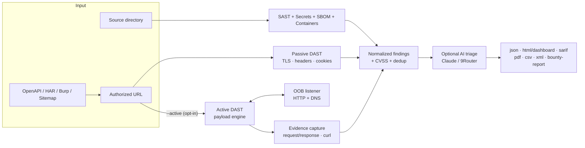

<p align="center">
  
</p>

<h3 align="center">AI-Assisted SAST · DAST · Black-Box Security Testing — in One CLI</h3>

<p align="center">
  <a href="https://goreportcard.com/report/github.com/Dicky1/VulnForge"></a>
  <a href="https://github.com/Dicky1/VulnForge/blob/main/go.mod"></a>
  <a href="LICENSE"></a>
  <a href="#contributing"></a>
  <a href="#active-opt-in-black-box-testing"></a>
</p>

---

VulnForge is an enterprise-grade security analysis CLI and orchestrator that detects project languages, plans and runs compatible static/dynamic scanners concurrently, normalizes and deduplicates findings, calculates CVSS v3.1 scores, and optionally validates high-priority vulnerabilities using AI (Anthropic Claude or 9Router).

It generates comprehensive technical audits, executive management dashboards, regulatory compliance matrices (OWASP Top 10, CWE Top 25, GDPR, PCI-DSS, HIPAA, SOC 2, ISO 27001), CycloneDX/SPDX SBOMs, and submission-ready Bug Bounty bundles tailored for platforms like HackerOne, Bugcrowd, Intigriti, YesWeHack, and Federacy — now with **active, opt-in black-box payload testing and out-of-band (OOB) confirmation**, each finding carrying real, redacted request/response evidence and a one-line `curl` to reproduce it.

> **Disclaimer**: "Zero-day" and AI-flagged findings are hypotheses and triage aids, not confirmed proof of an exploitable vulnerability. Active probing is disabled by default and must be explicitly opted into with `--active` against targets you are authorized to test. Always reproduce and manually verify findings in an authorized environment before disclosure.

---

## Why VulnForge

- **One pipeline, source to runtime.** Static analysis, dependency/secret scanning, container scanning, and both passive and active black-box testing feed the same findings model, the same AI triage, and the same reports.
- **Evidence you can actually hand to a program.** Every active finding carries the real request, the real (redacted) response, and a ready-to-run `curl` — not a guess.
- **Non-destructive by design.** Active probes are canary/benign-file/arithmetic checks only — no destructive payloads, no DoS, no real secret exfiltration — and everything stays inside a scope you define.
- **Built for bug bounty workflows.** Findings backed by real, confirmed evidence are routed differently from passive observations when generating a submission bundle, so you don't have to re-triage what the tool already proved.

---

## Key Features

- **Automated Polyglot Language Detection**: Scans and identifies Go, Python, JavaScript, TypeScript, Java, C/C++, PHP, Rust, Ruby, .NET, Swift, Kotlin, and Solidity repositories.
- **Unified Scanner Orchestration**: Runs 12+ scanners through a bounded concurrent worker pool:
  - **SAST**: Semgrep, Bandit, GoSec, ESLint, SpotBugs, PHPStan, Psalm, Cargo Audit, Brakeman, Slither, Clang Analyzer, and OWASP Dependency-Check.
  - **Secrets**: Built-in regex detection and Shannon entropy calculator with automatic credential redaction (`[REDACTED]`).
  - **Passive DAST**: Non-intrusive baseline HTTP scanner checking TLS enforcement, security headers (CSP, HSTS, X-Content-Type-Options, Referrer-Policy), and cookie attributes (`Secure`, `HttpOnly`, `SameSite`).
  - **🆕 Active Black-Box DAST** *(opt-in, `--active`)*: Injects a benign payload set — reflected XSS, SQLi (error-based & boolean-blind), open redirect, path traversal, SSTI, CRLF/header injection, and OOB-confirmed SSRF/XXE/command injection — into existing query parameters, through the same scope-enforced, rate-limited transport as passive DAST.
  - **🆕 Out-of-Band (OOB) Correlation**: A built-in, dependency-free HTTP + DNS listener records interactions by token and lets active probes wait for a real callback before confirming a blind SSRF/XXE/command-injection finding.
  - **🆕 Request/Response Evidence on Every Finding**: Captured method, URL, status, redacted headers, truncated bodies, and a reproducible `curl` command — rendered safely (HTML-escaped) in every report format, including the HTML dashboard.
  - **Containers**: Trivy or Grype integration for Docker/OCI container image scanning.
- **Endpoint Inventory Import**: Build a candidate endpoint manifest offline from an OpenAPI/Swagger document, a HAR capture, a Burp Suite XML export, or a sitemap — reviewed before anything is ever requested.
- **Docker Container Sandboxing**: Runs untrusted target repositories and scanners inside isolated Docker containers with `--cap-drop ALL`, `--security-opt no-new-privileges:true`, `--read-only` root, resource quotas, and `--network none`.
- **Untrusted README Protection**: Restricts auto-installation commands parsed from target repositories to strict allowlists; completely refuses execution on the host if Docker sandboxing is unavailable.
- **AI-Powered Validation & Remediation**: Uses Anthropic Claude or [9Router](https://github.com/decolua/9router) for advisory triage and remediation suggestions. AI does not delete findings or establish zero-day status; source snippets and paths are omitted from the default validation prompt. Scanner titles and metadata may still contain sensitive information; disable external AI for confidential scans.
- **Enterprise Policy Engine**: YAML-based rule enforcement supporting custom regex patterns, CWE filters, severity overrides, and suppression rules with precompiled regex caching.
- **Historical Tracking & Regressions**: Embedded SQLite storage (`analyzer.db`) for tracking scan history, new findings, fixed issues, and severity regressions (`--compare-with`).
- **Multi-Format Reporting**:
  - `json`: Machine-readable raw report.
  - `html` / `dashboard`: Standalone, interactive offline management dashboard with risk matrices, downtime projections, verification POCs, and per-finding request/response evidence.
  - `sarif`: GitHub Code Scanning / OASIS SARIF v2.1.0 compliant.
  - `pdf`: Executive-ready PDF report with severity badges and remediation roadmaps.
  - `csv`: Spreadsheet export with automatic CSV formula injection sanitization (CWE-1236).
  - `xml`: Standard XML interchange format.
  - `bounty-report`: Bug bounty submission bundles (`.bounty.json`, `.bounty.md`, `.bounty.html`, `.bounty.pdf`, `.bounty.txt`), with confirmed active findings carrying real evidence and a working `curl` reproduction.
- **CI/CD Integration Generator**: One-click generation of workflows for GitHub Actions, GitLab CI, Jenkinsfile, and Git pre-commit hooks.

---

## How It Fits Together



---

## Requirements

- **Go**: 1.24+
- **Toolchains & Scanners**: One or more scanners installed on `PATH` (or configured via Docker Sandbox).
- **AI Key (Optional)**: `ANTHROPIC_API_KEY` for Claude, or a running `9Router` instance (`http://localhost:20128`). Scanning degrades gracefully when AI is unavailable.

---

## Installation & Build

Clone the repository and build the binary:

```bash
git clone https://github.com/Dicky1/VulnForge.git
cd VulnForge
go mod download
go test ./...
go build -o analyzer.exe ./cmd/analyzer
```

---

## Quick Start: Menjalankan Scan

### 1. Basic Source Scan
Scan a project directory and export to JSON:

```powershell
.\analyzer.exe --target "C:\path\to\project" --output report.json
```

Or on Linux / macOS:

```bash
./analyzer --target /path/to/project --output report.json
```

### 2. Black-Box AuthZ / Logic Probing (new)

Authorized active (non-destructive) checks for BOLA/IDOR, parameter tampering, and race conditions:

```powershell
# AuthZ diff (BOLA/IDOR) with role matrix
.\analyzer.exe --dast-url "https://staging.example.com" --authz-matrix authz.yaml --output report.json

# Parameter tampering fuzzer (from OpenAPI-style manifest)
.\analyzer.exe --dast-url "https://staging.example.com" --tamper-manifest tamper.yaml --output report.json
```

- `--authz-matrix`: YAML with origin, sessions (bearer/cookie + priority), and endpoints. Flags endpoints where a lower-privileged session receives an equivalent response to a higher-privileged one.
- `--tamper-manifest`: YAML with origin and endpoints + params. Probes negative/zero/huge/string/empty/null values and flags unexpected 2xx or 5xx.
- Concurrency harness available programmatically (`scanner.ConcurrencyHarness`) to detect duplicate/oversell on mutating endpoints.

### 3. Passive DAST Scan
Check the HTTPS, headers, and cookie attributes observed at an authorized endpoint:

```powershell
.\analyzer.exe --dast-url "https://staging.example.com" --output report.json
```

A URL-only scan uses built-in HTTP checks without AI validation. Keep `analyzer.target_path` empty in the selected config for this mode. The report stores the endpoint without its query or fragment.

Use the `dast` subcommand to select web-only mode even when the config has a source target. To check multiple endpoints, save an explicit list in `endpoints.yaml`.

```yaml
origin: https://staging.example.com
paths:
  - /
  - /login
  - /api/health
```

```powershell
go run ./cmd/analyzer dast --dast-targets endpoints.yaml --export-format json,html --output report.json
```

The manifest accepts up to 100 paths under one origin. The HTTP client sends GET requests sequentially, honors the configured timeout, and limits redirects to the original origin or a standard HTTP-to-HTTPS upgrade. `--dast-interval` defaults to `250ms`, and `--dast-max-requests` defaults to 100. Both apply across the entire run and include redirects. An HTTP 429 response stops further requests in the run. The client honors `HTTP_PROXY`, `HTTPS_PROXY`, and `NO_PROXY`. Use `--dast-no-proxy` for direct connections.

For authenticated staging checks, supply an existing session with `--dast-session cookie` and `VULNFORGE_DAST_COOKIE` (a Cookie header value), or `--dast-session bearer` and `VULNFORGE_DAST_BEARER_TOKEN` (the token alone). Use the `dast` subcommand and an HTTPS origin. Reports include endpoint outcomes and evidence such as status, header name, and missing attributes per cookie. Credentials, cookie values, raw headers, query strings, and response bodies are excluded for passive checks. Keep sensitive data out of endpoint path segments. Authenticated redirects to a different path show a redacted final path.

Generate a candidate manifest offline from a local OpenAPI document, HAR file, Burp XML item export, or sitemap URL set:

```powershell
go run ./cmd/analyzer dast inventory --origin https://staging.example.com --openapi openapi.yaml
```

The inventory command prints YAML to review and save. Use `--har`, `--burp`, or `--sitemap` for those inputs. Imported paths drop query strings, and captured GET URLs must match the selected origin. Review path segments before saving or sharing the generated manifest.

### 3. Active (Opt-In) Black-Box Testing

Active probing never runs unless you pass `--active`, and it only mutates query parameters that already exist on the authorized URL you give it — it never invents new endpoints or parameters.

```bash
go run ./cmd/analyzer dast --dast-url "https://staging.example.com/search?q=test" --active --output report.json
```

This sends the standard non-destructive probe set (reflected-XSS canary, SQLi error-based and boolean-based pairs, open redirect, path traversal against benign well-known files, an SSTI arithmetic probe, and CRLF/host-header injection) against every existing query parameter, reusing the exact same scope-enforcement, rate limiting, and optional session (`--dast-session`) as passive DAST. Every attempt, and the one baseline request per parameter, counts against `--dast-max-requests`.

To also confirm blind SSRF/XXE/command-injection via an out-of-band callback, point the probes at a reachable callback host and, optionally, run the built-in listener yourself:

```bash
go run ./cmd/analyzer dast --dast-url "https://staging.example.com/fetch?url=https://example.com" \
  --active \
  --dast-oob-host "oob.your-collaborator.example" \
  --dast-oob-listen ":8080" \
  --dast-oob-wait 5s \
  --output report.json
```

`--dast-oob-host` must be a domain you control, with wildcard DNS pointed at wherever `--dast-oob-listen` is reachable — the listener correlates the per-probe token from the inbound Host header (or, for path-based callbacks, the first URL segment) against the token embedded in the probe it sent. Run the listener on a separate reachable host for a real engagement; the flag just makes a quick local setup easy. Every resulting finding — in-band or OOB-confirmed — carries the captured request, the captured response (or the OOB interaction's source IP, protocol, and timestamp), and a `curl` command ready to reproduce it, visible in every report format including the HTML dashboard.

Add a source directory to combine static and runtime findings in the same report:

```powershell
.\analyzer.exe --target "C:\path\to\project" `
  --dast-url "https://staging.example.com" `
  --export-format json,html,dashboard,sarif,pdf,csv `
  --output report.json
```

### 4. Bug Bounty Submission Bundle
Generate submission-ready drafts for a specific bug bounty platform:

```powershell
.\analyzer.exe --target "C:\path\to\project" `
  --policy policies/default.yaml `
  --export-format json,html,sarif,bounty-report `
  --bounty-program hackerone `
  --output report.json
```
*Supported platforms*: `hackerone`, `bugcrowd`, `intigriti`, `yeswehack`, `federacy`.

A finding confirmed by an active probe (reflected payload, leaked DB error, off-host redirect, OOB callback, etc.) is treated as reproduced impact — its bundle entry carries the real `curl` command and a description of what was actually observed. A purely passive observation (a missing header, a cookie attribute) is still flagged for independent impact assessment before submission, exactly as before.

### 5. Historical Differential Scan
Track scan history in SQLite and compare against a previous scan ID to detect new bugs or regressions:

```powershell
# First scan with history tracking:
.\analyzer.exe --target "C:\path\to\project" --track-history --database analyzer.db

# Follow-up scan compared to previous run:
.\analyzer.exe --target "C:\path\to\project" --track-history --compare-with scan-1718000000000
```

Use the same source directory, DAST endpoint list, and session mode for both runs. The CLI logs incomplete checks and includes them in JSON (`incomplete_checks`), HTML, PDF, XML, and SARIF. Partial scans still produce reports. A history comparison involving an incomplete scan returns an error after exporting the current report. If no DAST endpoint could be checked, the CLI exports its outcomes and then exits with an error.

### 6. SBOM & Container Image Scanning
Generate CycloneDX or SPDX Software Bill of Materials, and scan container images via Trivy/Grype:

```powershell
.\analyzer.exe --target "C:\path\to\project" `
  --generate-sbom cyclonedx `
  --scan-containers "docker.io/library/nginx:alpine"
```

---

## CLI Options Reference

| Flag | Type | Description |
| :--- | :--- | :--- |
| `--target` | `string` | Path to the source code directory to scan (or positional argument). |
| `--config` | `string` | Config YAML path (or `ANALYZER_CONFIG`). |
| `--output` | `string` | Base path for exported reports (default: `report.json`). |
| `--export-format` | `string` | Comma-separated: `json,html,dashboard,pdf,sarif,xml,csv,bounty-report`. |
| `--policy` | `string` | Path to custom YAML security policy file. |
| `--dast-url` | `string` | Authorized runtime URL for passive baseline HTTP scanning (and the single target for `--active`). May be used by itself. |
| `--dast-targets` | `string` | YAML manifest of multiple endpoints under one origin (`dast` subcommand). Not combinable with `--active`. |
| `--dast-session` | `string` | `cookie` or `bearer`, paired with `VULNFORGE_DAST_COOKIE` / `VULNFORGE_DAST_BEARER_TOKEN`. Requires HTTPS. |
| `--dast-interval` | `duration` | Delay between DAST requests (default `250ms`). |
| `--dast-max-requests` | `int` | Request budget for the whole DAST run, passive or active (default `100`). |
| `--dast-no-proxy` | `bool` | Ignore proxy environment variables for DAST. |
| 🆕 `--active` | `bool` | Enable opt-in active payload injection against existing query parameters of `--dast-url`. Requires the `dast` subcommand and a single URL. |
| 🆕 `--dast-oob-host` | `string` | Externally reachable host used to build out-of-band callback URLs for blind SSRF/XXE/command-injection probes. |
| 🆕 `--dast-oob-listen` | `string` | Local address to bind the built-in OOB HTTP listener (e.g. `:8080`). Requires `--active`. |
| 🆕 `--dast-oob-wait` | `duration` | How long to wait for an out-of-band callback per probe (default `3s`). |
| `--track-history` | `bool` | Store scan results in the SQLite database for historical tracking. |
| `--database` | `string` | Custom path to SQLite database (default from `config.yaml`). |
| `--compare-with` | `string` | Historical report ID to run differential regression analysis against. |
| `--bounty-program` | `string` | Platform adapter (`hackerone`, `bugcrowd`, `intigriti`, `yeswehack`, `federacy`). |
| `--scan-containers`| `string` | Explicit Docker/OCI image reference to scan with Trivy/Grype. |
| `--generate-sbom` | `string` | Format for SBOM generation (`cyclonedx` or `spdx`). |
| `--github-actions` | `bool` | Generates `.github/workflows/security-scan.yml` in target repo. |
| `--gitlab-ci` | `bool` | Generates `.gitlab-ci.yml` in target repo. |
| `--jenkins` | `bool` | Generates `Jenkinsfile` in target repo. |
| `--pre-commit` | `bool` | Generates `.git/hooks/pre-commit` hook in target Git repo. |

The `dast inventory` subcommand additionally accepts `--origin`, `--openapi`, `--har`, `--burp`, and `--sitemap` — see [Quick Start §2](#2-passive-dast-scan).

---

## Environment & Configuration

Copy `.env.example` to `.env`:

```powershell
Copy-Item .env.example .env
```

Key environment variables:

| Variable | Default | Description |
| :--- | :--- | :--- |
| `ANALYZER_ENV_FILE` | `.env` | Custom path to `.env` file. |
| `ANALYZER_AI_ENABLED` | `true` | Set to `false` to run scanner-only offline mode without AI. |
| `ANALYZER_AI_PROVIDER` | `anthropic`| AI provider: `anthropic` or `9router`. |
| `ANTHROPIC_API_KEY` | `""` | Anthropic API key for Claude. |
| `NINEROUTER_URL` | `http://localhost:20128` | Base URL for local or remote 9Router instance. |
| `NINEROUTER_MODEL` | `cc/claude-opus-4-6` | Model ID configured in 9Router. |
| `NINEROUTER_KEY` | `""` | Optional API key for 9Router. |
| `VULNFORGE_DAST_COOKIE` | `""` | Cookie header value used with `--dast-session cookie`. |
| `VULNFORGE_DAST_BEARER_TOKEN` | `""` | Bearer token used with `--dast-session bearer`. |
| `ANALYZER_SANDBOX_ENABLED` | `false` | Enable required scanner isolation; configured scanner execution fails closed if Docker or an image is unavailable. Explicit container image scanning is separate. |
| `ANALYZER_AUTO_INSTALL` | `false` | Allow auto-installing missing scanners (strictly validated). |
| `ANALYZER_TOOL_PATHS` | `""` | Extra paths appended to system `PATH` (separated by platform delimiter). |

Advanced settings such as timeouts, token budgets, scanner concurrency limits, and financial risk multipliers can be customized in [`config/config.yaml`](config/config.yaml).

---

## Language & Scanner Support Matrix

| Language | Supported Scanners | Sandbox Image Available |
| :--- | :--- | :---: |
| **Go** | GoSec | Yes (`vulnforge-gosec`) |
| **Python** | Bandit, Semgrep | Yes (`vulnforge-bandit`, `returntocorp/semgrep`) |
| **JavaScript / TypeScript** | ESLint (`@microsoft/eslint-plugin-sdl`), Semgrep | Yes (Semgrep) |
| **Java** | SpotBugs, OWASP Dependency-Check, Semgrep | Yes (Semgrep) |
| **PHP** | PHPStan, Psalm, Semgrep | Yes (Semgrep) |
| **Rust** | Cargo Audit, Semgrep | Yes (Semgrep) |
| **Ruby** | Brakeman | Host |
| **C / C++** | Clang Static Analyzer (`scan-build`) | Host |
| **Solidity** | Slither (Foundry & Hardhat support) | Yes (`vulnforge-slither`) |
| **Kotlin / .NET / Swift** | Semgrep | Yes (Semgrep) |
| **Containers** | Trivy, Grype | Host / Daemon |
| **Secrets** | Native High-Entropy & Pattern Detector | Built-in |
| **Web Endpoint** | Native Passive & Active DAST | Built-in |

---

## Security Hardening Details

VulnForge implements defense-in-depth principles:
1. **Command Injection Prevention**: Subprocess calls avoid shell wrappers (`sh -c` or `cmd.exe /c`), passing parameters strictly as tokenized argument slices. Every `curl` command captured as evidence is built with POSIX-safe single-quote escaping — a malicious response or header value can never break out of its quoting.
2. **Container Isolation**: Scanner subprocesses run with dropped Linux capabilities (`--cap-drop ALL`), disabled privilege escalation (`no-new-privileges`), and read-only target mounts (`/workspace:ro`).
3. **Secret Redaction**: The native secret detector redacts matched source lines; passive DAST omits cookie values and query strings; active-DAST evidence redacts `Authorization`, `Cookie`, `Set-Cookie`, and other sensitive headers before they are ever written to a report. Third-party scanner output is not a guarantee of complete redaction; protect report files and review them before sharing.
4. **Data Minimization for AI**: When requesting remediation diffs, source snippets are omitted from prompts to prevent source code exfiltration to external LLMs.
5. **CSV Formula Injection Mitigation**: All CSV exported fields are sanitized against formula injection (CWE-1236) by prepending `'` to fields starting with `=`, `+`, `-`, or `@`.
6. **Parameterized SQL**: Scan history transactions utilize parameterized SQL queries exclusively.
7. **XSS Protection**: HTML executive dashboards leverage Go's contextual `html/template` auto-escaping — including for captured request/response evidence, which routinely contains the attack payload itself (e.g. a reflected-XSS canary). Opening a report can never execute the payload it is reporting.
8. **Non-Destructive, Scope-Enforced Active Probing**: Active payloads are canary/benign-file/arithmetic checks only (no destructive commands, no data exfiltration, no DoS). Every request — baseline, probe, and redirect — is re-checked against the authorized scope, including the resolved IP (private/loopback/link-local/metadata ranges are refused), before it is ever sent.

---

## Testing & Quality

Run the comprehensive unit test suite:

```bash
go test -v ./...
```

Run with the race detector (recommended before any release):

```bash
go test -race ./...
```

Verify formatting and linting:

```bash
go vet ./...
gofmt -l .
```

---

## Roadmap

VulnForge's black-box capability is being built out deliberately, in reviewable layers:

- [x] Passive baseline DAST (TLS, headers, cookies)
- [x] Endpoint inventory import (OpenAPI, HAR, Burp, sitemap)
- [x] Active, opt-in payload engine with scope enforcement
- [x] Out-of-band (OOB) HTTP + DNS listener and correlation
- [x] Request/response evidence on every finding, rendered safely in every report format
- [ ] Same-scope crawler to discover endpoints without an import
- [ ] Body/header/path injection points (beyond query parameters) and non-GET methods
- [ ] Form-based login with session re-authentication on logout detection
- [ ] A second identity for basic IDOR/access-control comparison checks
- [ ] Direct `--active` consumption of a `dast inventory` manifest, instead of one URL at a time

See [`VALIDATION.md`](VALIDATION.md) for current test coverage and known gaps ahead of a tagged release.

---

## Contributing

Issues and pull requests are very welcome — whether that's a new active-probe class, a new importer format, a bug fix, or just a clearer error message.

1. Fork the repo and create a branch from `main`.
2. Run `go build ./... && go vet ./... && go test -race ./...` before opening a PR.
3. Keep active probes non-destructive and scope-enforced — that invariant is load-bearing for anyone running this against a real program.
4. Describe what you tested it against (even a local `httptest` server) in the PR description.

If you're not sure where to start, the unchecked items in the [Roadmap](#roadmap) above are all good first issues.

---

## License

This project is licensed under the [MIT License](LICENSE).

### Candidate validation notes

This working tree is a pre-push candidate, not a validated release. See `VALIDATION.md` for test coverage, unresolved gaps, and release checks. Do not run source scanners on untrusted code outside appropriate isolation. Use only authorized targets and a trusted output directory.
